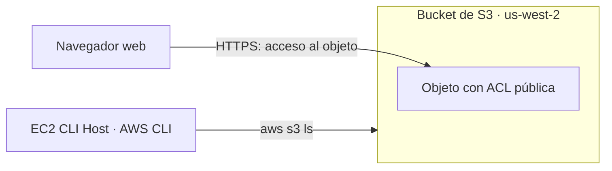

# Amazon S3: Laboratorio de desafío (Lab 184)

Proyecto práctico del bootcamp de Administrador Cloud en AWS. Documenta la creación de un bucket de **Amazon S3**, la carga de un objeto, el control de su visibilidad (privado por defecto, público solo para ese objeto) y la verificación del contenido con la **AWS CLI** desde una instancia EC2.

---

## Objetivos

- Crear un bucket de S3.
- Cargar un objeto en el bucket.
- Acceder al objeto mediante un navegador web.
- Enumerar el contenido del bucket con la AWS CLI.

## Arquitectura



La instancia **CLI Host** se usa como terminal de administración: desde ella se configura la AWS CLI y se consulta el bucket. El acceso desde el navegador comprueba el comportamiento de los permisos del objeto.

## Tecnologías y servicios

| Categoría | Detalle |
|---|---|
| Almacenamiento | Amazon S3 (bucket y objetos) |
| Cómputo | Amazon EC2 (instancia CLI Host) |
| Herramientas de gestión | AWS CLI, EC2 Instance Connect, Consola de administración de AWS |
| Conceptos aplicados | Permisos de objetos en S3, ACL, acceso público frente a acceso privado, verificación de identidad con STS |

## Estructura del repositorio

```text
├── README.md
└── images/
    ├── 01_ec2_cli_host_instancia.png
    ├── 02_ec2_instance_connect.png
    ├── 03_cli_host_terminal.png
    ├── 04_aws_cli_configure.png
    ├── 05_s3_bucket_creado.png
    ├── 06_s3_acceso_denegado.png
    ├── 07_s3_objeto_hecho_publico.png
    ├── 08_s3_objeto_acceso_publico.png
    └── 09_cli_s3_ls_contenido.png
```

> **Nota de seguridad:** las capturas se editaron para ocultar las claves de acceso, el identificador de cuenta y los datos personales del usuario. Las credenciales del laboratorio son temporales y nunca deben publicarse en un repositorio.

---

## Fase 1: Conexión a la instancia CLI Host

### 1.1 Localización de la instancia

En la consola de EC2, sección *Instancias*, se identificó la instancia **CLI Host**, aprovisionada por el laboratorio, en estado *En ejecución* y con las comprobaciones de estado superadas (3/3).


### 1.2 Conexión con EC2 Instance Connect

Desde el botón *Conectar* se eligió **EC2 Instance Connect**, que abre una terminal en el navegador con claves SSH temporales administradas por AWS, sin necesidad de gestionar un archivo de claves propio.


### 1.3 Terminal lista

La terminal quedó abierta sobre el CLI Host y se utilizó para el resto del laboratorio.


---

## Fase 2: Configuración de la AWS CLI

Se configuró un perfil con `aws configure`, usando las credenciales temporales que entrega el laboratorio, y se confirmó la identidad activa con `aws sts get-caller-identity`. Esa verificación evita ejecutar comandos con la cuenta o el usuario equivocados.

```bash
aws configure
# AWS Access Key ID:      <ACCESS_KEY_ID>
# AWS Secret Access Key:  <SECRET_ACCESS_KEY>
# Default region name:    us-west-2
# Default output format:  json

aws sts get-caller-identity
```


---

## Fase 3: Desafío con Amazon S3

### 3.1 Creación del bucket

Se creó un bucket de propósito general en la región **us-west-2 (Oregón)**, con un nombre globalmente único.


### 3.2 Carga del objeto

Se cargó en el bucket un archivo de prueba, `01_ec2_instances_list.png` (unos 62 KB), para practicar el control de acceso sobre un objeto concreto.

### 3.3 Acceso sin permisos: AccessDenied

Al abrir la URL del objeto desde una ventana de incógnito, S3 respondió `AccessDenied`. Es el comportamiento esperado: los objetos nuevos son **privados por defecto** y solo su propietario puede leerlos.


### 3.4 Objeto público, no el bucket

Después de ajustar los permisos que S3 exige para ello, se aplicó la acción **Hacer público con ACL** únicamente sobre el objeto. El panel de estado confirmó que el cambio se aplicó correctamente a 1 objeto y a ninguno con error. Hacer público solo el objeto, y no el bucket completo, limita la exposición al mínimo necesario.


### 3.5 Acceso desde el navegador

Con el permiso aplicado, la misma URL que antes devolvía `AccessDenied` mostró la imagen en la ventana de incógnito, lo que confirma que el acceso público funciona.


### 3.6 Listado del contenido con la AWS CLI

Desde el CLI Host se enumeró el contenido del bucket y apareció el objeto cargado.

```bash
aws s3 ls s3://<S3_BUCKET_NAME>/
```


---

## Resultados

| Objetivo | Resultado |
|---|---|
| Crear un bucket de S3 | Bucket creado en us-west-2 |
| Cargar un objeto | Archivo `01_ec2_instances_list.png` almacenado en el bucket |
| Acceder al objeto desde el navegador | `AccessDenied` antes del cambio de permisos; acceso correcto después |
| Enumerar el contenido con la AWS CLI | Objeto listado con `aws s3 ls` |

## Aprendizajes clave

- **Privado por defecto:** un objeto nuevo en S3 no es accesible públicamente hasta que se concede ese permiso de forma explícita.
- **Granularidad del permiso:** se puede abrir un único objeto sin hacer público el bucket entero.
- **Verificación de identidad:** `aws sts get-caller-identity` confirma con qué credenciales actúa la CLI antes de operar sobre los recursos.
- **Manejo de credenciales:** las claves de acceso son secretos; se ocultan en las capturas y no se versionan en repositorios.

## Mejoras posibles en un entorno de producción

- Sustituir las claves de acceso de larga duración por **roles de IAM** con credenciales temporales, como se hizo con el perfil de instancia en el Lab 183 de este portafolio.
- Evitar los objetos públicos: servir contenido estático con **Amazon CloudFront** y *Origin Access Control*, o compartirlo con **URL prefirmadas** de caducidad corta.
- Volver a activar *Bloquear acceso público* en el bucket una vez terminada la demostración.
- Añadir cifrado, versionado y reglas de ciclo de vida para proteger los datos y controlar el costo.
- Eliminar el bucket y sus objetos al terminar las pruebas en una cuenta propia, para evitar cargos.
